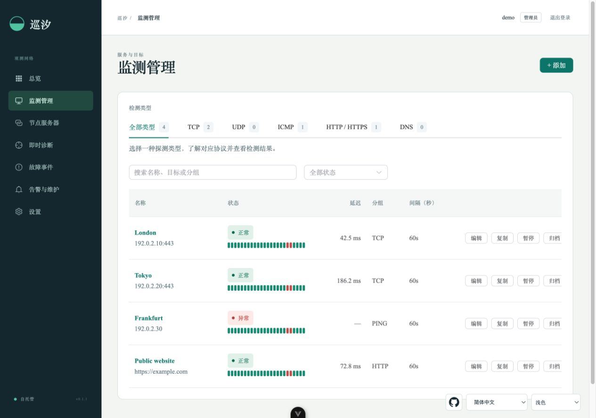

# 巡汐网页面板

[English](README.md) | [产品与 PRD](https://github.com/sihuangtech/probelune) | [探测节点](https://github.com/sihuangtech/probelune-node)

巡汐 Probelune 是自托管的多位置服务监测与网络诊断面板，用于集中查看自建节点的监测结果、管理告警，并从网页发起跨位置诊断。

## Probelune 项目仓库

Probelune 由六个仓库组成，当前仓库是 **probelune-dashboard**。可通过下表了解并访问其他组件。

自部署时从网页面板和探测节点开始，移动端与桌面端连接同一个面板，协议仓库为开发者提供共享定义。

| 仓库 | 用途 |
| --- | --- |
| [probelune](https://github.com/sihuangtech/probelune) | 项目总览、架构与部署指南 |
| [probelune-dashboard](https://github.com/sihuangtech/probelune-dashboard) | 网页控制台与 Go API 服务端 |
| [probelune-node](https://github.com/sihuangtech/probelune-node) | 部署在监测网络中的探测执行器 |
| [probelune-mobile](https://github.com/sihuangtech/probelune-mobile) | Flutter Android 与 iOS 移动客户端 |
| [probelune-desktop](https://github.com/sihuangtech/probelune-desktop) | Electron 桌面客户端与诊断工具 |
| [probelune-contracts](https://github.com/sihuangtech/probelune-contracts) | 共享 Go 数据结构、参数校验与接口协议 |


## 界面预览



截图使用演示数据。应用支持语言切换，以及浅色、深色和跟随系统三种主题。

## 功能

1. 总览清单与监测列表支持按 TCP、UDP、ICMP、HTTP/HTTPS、DNS 筛选，并提供每种探测的简短说明；页面间共享并记住类型选择，列表中可叠加名称搜索和状态筛选。
2. HTTP/HTTPS、TCP、UDP、ICMP、DNS 持续监测，显式选择节点，分组、标签、搜索、复制、暂停、归档及配置版本。
3. 目标状态清单、可用率与覆盖率、错误证据、网络耗时、证书有效期、长期聚合历史。
4. 连续失败/恢复阈值；节点离线单独提示，不冒充所有站点宕机。
5. 按批次查看 HTTP/DNS/TCP/UDP/ICMP/MTR/路由追踪即时诊断、取消及脱敏 JSON/CSV 导出。
6. 历史明细支持时间、节点、结果、失败阶段筛选及分页。
7. 事件时间线、确认、备注、限时静默、维护窗口、SMTP、签名 Webhook 及发送重试。
8. 管理员/操作员/只读成员、一次性节点注册与手机配对、会话撤销、凭据加密、公开只读状态页。
9. 接入独立桌面和移动客户端；可选配置自己的 Firebase 项目发送原生推送。

在需要观察的公网或内网部署探测节点，即可接入自己的面板。初版面向个人和小团队。

## 源码部署

适用于 Linux 和 macOS。安装 [Go](https://go.dev/doc/install) 和 [Node.js](https://nodejs.org/en/download)；当前验证版本为 Go **1.27.3**、Node.js **26.12.1**。克隆、编译并启动：

```sh
git clone https://github.com/sihuangtech/probelune-dashboard.git
cd probelune-dashboard
./scripts/build.sh
./dist/probelune-dashboard --listen 127.0.0.1:8080 --data ./data --web ./dist/web
```

保持该终端运行，在**同一项目目录**打开第二个终端，读取首次初始化令牌：

```sh
cat ./data/setup-token
```

访问 `http://localhost:8080`，输入令牌，创建密码至少 12 字符的管理员。按 Ctrl-C 停止服务；下次使用同一数据目录执行相同的启动命令即可。

编译脚本会安装锁定的网页依赖，生成 `dist/probelune-dashboard` 和 `dist/web/`。运行时只需程序、网页静态文件和可写的数据目录，SQLite 数据库会自动创建。升级时保留 `data/`。Linux 常驻运行的安装命令见 [部署文档](docs/OPERATIONS.md#linux-service-with-systemd)。

## Docker 快速启动

```sh
git clone https://github.com/sihuangtech/probelune-dashboard.git
cd probelune-dashboard
docker compose build --pull
docker compose up -d
docker compose exec dashboard cat /data/setup-token
```

访问 `http://localhost:8080`，输入初始化令牌，创建密码至少 12 字符的管理员。管理员创建成功后，首次初始化入口关闭。

Dockerfile 使用当前已核对的稳定补丁版本：Node.js **26.12.1**、Go **1.27.3**、Alpine **3.24.3**。官方来源及刷新步骤见 [依赖记录](docs/DEPENDENCIES.md)。

## 配置监测

在面板机注册 `panel` 角色的探测执行端后，持续监测和新发起的诊断统一由面板机执行。总览按目标展示状态、延迟和最近检测时间；远端节点继续上报在线状态。

依次配置实例 HTTPS 地址与时区、创建探测节点、部署节点、创建监测并选择执行位置，再测试通知。节点默认仅允许公网目标；内网监测需显式允许 CIDR。两个同机进程不代表两个真实地区。

两种启动方式默认都只监听主机回环端口，远程访问前配置 HTTPS 反向代理。Docker 数据在 `dashboard-data` 卷中，升级时保留该卷。

## 可用性历史与状态页

在监测配置中设置探测间隔，单位为秒，支持 15—86400 秒且大于单次超时。例如 `60` 表示每分钟探测，`900` 表示每 15 分钟探测。

监测详情提供历史色块、证据与明细。在实例设置开启“公开状态页”，并为指定监测勾选“公开到状态页”后，可通过 `/status` 分享其汇总状态。

色块粒度独立于探测频率，可选 15 分钟、每小时或自定义 5 分钟倍数。回看范围和粒度可配置，最长 30 天、最多 2016 个色块。灰色表示无有效样本，斜纹表示覆盖不足；点击色块可查看统计或对应历史。可用率按实际观测计算，缺测通过覆盖率单独呈现。

UDP 检测支持 UTF-8/HEX 请求与可选响应内容断言，必须收到非空响应才算成功；超时不证明端口关闭。选择声明支持 UDP 的节点执行。

## 本地开发

手动执行 Go 命令前，在仓库根目录运行 `. ./scripts/go-env.sh`。

开发网页时，先启动 8080 后端，再在 `web/` 执行 `npm ci` 和 `npm run dev`。Vite 将 API 请求代理到后端。完整双终端命令见 [开发文档](docs/ARCHITECTURE.md#developer-loop)。

## 文档

1. [部署文档](docs/OPERATIONS.md)：宿主机服务、Docker、HTTPS、备份恢复与升级。
2. [开发文档](docs/ARCHITECTURE.md)：项目架构与本地开发。
3. [通知配置](docs/NOTIFICATIONS.md)：SMTP、Webhook 与手机推送。
4. [依赖记录](docs/DEPENDENCIES.md)：核对过的版本与更新方式。
5. [API 文档](https://github.com/sihuangtech/probelune-contracts/tree/main/docs)：HTTP 接口与节点协议。
6. [验收记录](https://github.com/sihuangtech/probelune/blob/main/docs/acceptance.md)：已验证结果及环境边界。
7. [发布记录](https://github.com/sihuangtech/probelune-dashboard/releases)
8. [贡献指南](CONTRIBUTING.md)
9. [安全报告](SECURITY.md)

验证命令：网页 `npm run lint && npm run build`；后端在 `GOWORK=off` 下执行 `go vet ./...`、`go test ./...` 和 `go build ./cmd/server`。采用 [GPL-3.0-or-later](LICENSE) 开源。

## 星标历史

[](https://star-history.com/#sihuangtech/probelune-dashboard&Date)

## 联系开发者

1. 开发者: [Snake Konginchrist](https://github.com/Snake-Konginchrist)
2. 邮箱: [developer@skstudio.cn](mailto:developer@skstudio.cn)
3. 问题反馈: [GitHub Issues](https://github.com/sihuangtech/probelune-dashboard/issues)

[本地化说明](docs/LOCALIZATION.md)
